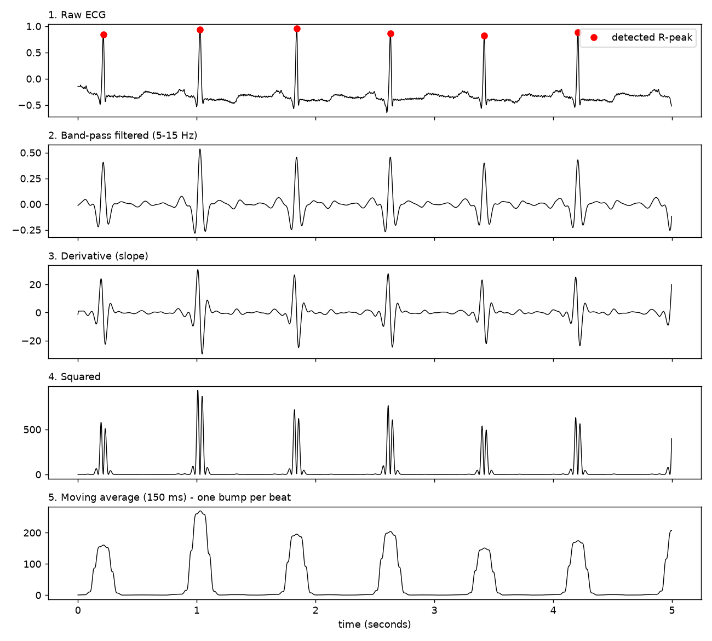
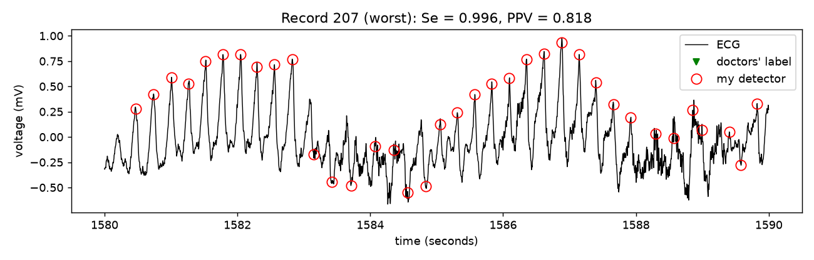
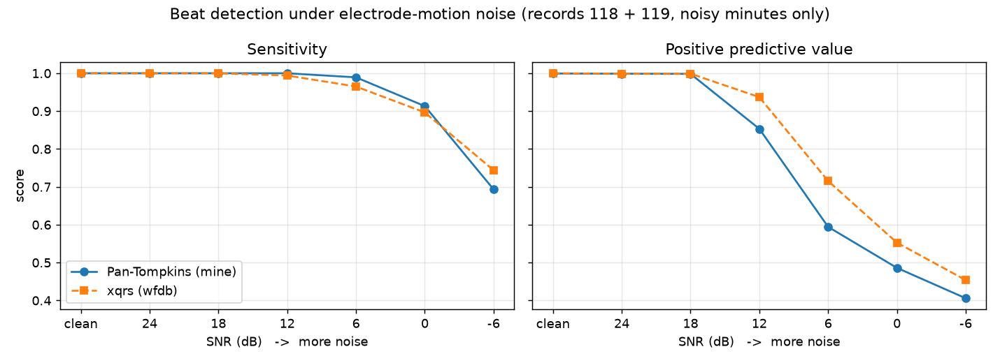
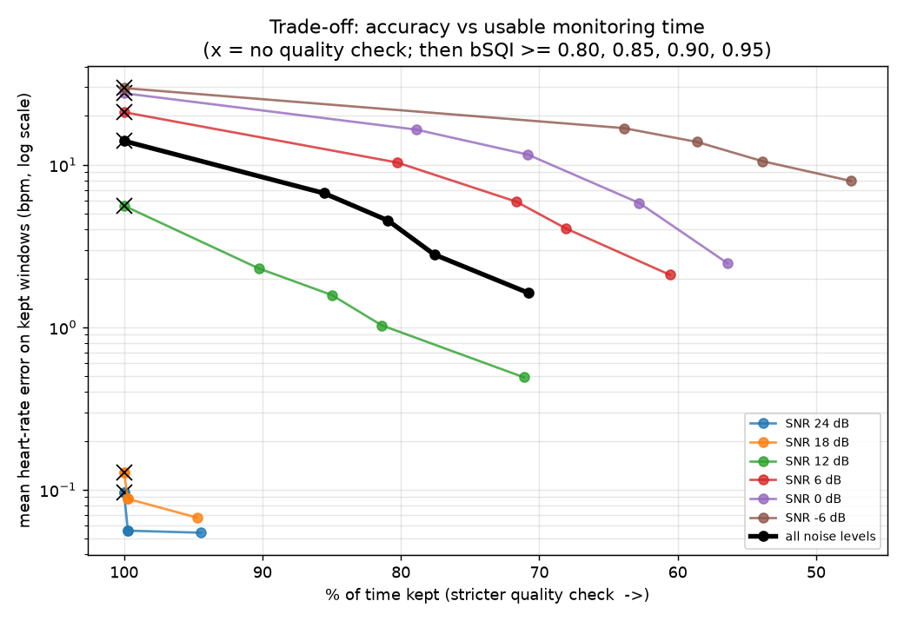
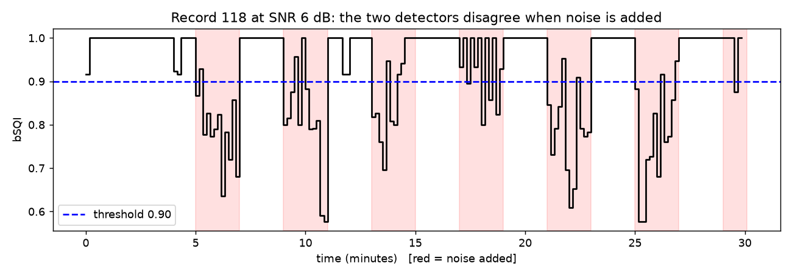

# Reliable ECG Heart-Rate Monitoring under Motion Artefacts

**Question:** when can you trust a heart rate from a wearable or in-vehicle ECG
(for example electrodes on a steering wheel), where hand and body movement add noise?

**What this project does**
1. Implements the **Pan–Tompkins** R-peak detector from scratch in Python and checks it
   against cardiologist beat labels on the **MIT-BIH Arrhythmia Database**.
2. Stress-tests it with **real recorded electrode-motion noise** at controlled SNRs
   (24 dB to −6 dB) from the **MIT-BIH Noise Stress Test Database**.
3. Adds a **signal-quality index (bSQI)**: two different detectors must agree before a
   10-second window is trusted. Measures the trade-off between **heart-rate accuracy**
   and **% of monitoring time kept**.

All processing is offline on public data. No hardware was used.

---

## Results

### Step 1: detector on clean hospital ECG (MIT-BIH, 48 records, 109,494 beats)

| | Sensitivity | Positive predictive value |
|---|---|---|
| **Overall** | **99.71 %** | **99.23 %** |

A detection counts as correct within 150 ms of a labelled beat (ANSI/AAMI EC57 convention).
Full per-record table: [results/step1_mitdb.csv](results/step1_mitdb.csv).

Hardest records: **207** (PPV 81.9 %: a ventricular-flutter episode, where the labels mark no
individual beats but the detector fires on the flutter waves), **108** (PPV 85.1 %: large P and
T waves and noise produce extra detections) and **203** (Se 97.7 %: many abnormal beat shapes).




### Step 2: electrode-motion noise (records 118 + 119, noisy minutes only)

| SNR (dB) | clean | 24 | 18 | 12 | 6 | 0 | −6 |
|---|---|---|---|---|---|---|---|
| Se (Pan–Tompkins) | 100 % | 100 % | 100 % | 100 % | 98.9 % | 91.3 % | 69.3 % |
| PPV (Pan–Tompkins) | 99.9 % | 99.9 % | 99.8 % | **85.3 %** | **59.4 %** | 48.6 % | 40.6 % |
| PPV (xqrs, for comparison) | 100 % | 99.9 % | 99.9 % | 93.7 % | 71.6 % | 55.3 % | 45.4 % |

**Detection breaks down between 18 and 12 dB.** The first thing to fail is PPV: noise
spikes are counted as extra beats. Missed beats (lower Se) only become a big problem at
0 dB and below. Filtering cannot remove electrode-motion noise because its frequencies
overlap the QRS band (5–15 Hz).



### Step 3: quality check, accuracy vs usable time

Mean absolute heart-rate error on kept 10-second windows (all noise levels pooled, whole recordings):

| Quality check | HR error | Time kept |
|---|---|---|
| none | 14.0 bpm | 100 % |
| bSQI ≥ 0.80 | 6.7 bpm | 85.6 % |
| bSQI ≥ 0.90 | **2.8 bpm** | **77.6 %** |
| bSQI ≥ 0.95 | 1.6 bpm | 70.8 % |

At SNR 6 dB alone: no check gives 21.1 bpm error, and bSQI ≥ 0.90 gives **4.1 bpm** while keeping 68 % of the time.




Full table: [results/step3_quality.csv](results/step3_quality.csv).

---

## Limitations
- The noise is real electrode-motion noise but **added to only 2 clean records** (118, 119).
- **No real steering-wheel or wearable data**, and no data from my own board (it is designed, not built).
- bSQI uses only **one second detector** (xqrs). Both detectors can be fooled in the same way.
- **Offline processing:** `filtfilt` is zero-phase but needs future samples. A real-time
  version needs a causal filter, which adds delay.
- Ventricular-flutter episodes were not excluded from scoring, which lowers PPV on record 207.

## Next steps
- Test on real in-vehicle or wearable ECG.
- Add motion context to the quality check (accelerometer, or vehicle data such as steering angle).
- Use only trusted windows for arrhythmia (atrial fibrillation) detection.

---

## How to run
```
pip install -r requirements.txt
python run_step1_mitdb.py      # downloads the data (~115 MB) the first time
python run_step2_noise.py
python run_step3_quality.py
```

## Files
| File | What it does |
|---|---|
| `src/data.py` | downloads and loads recordings and beat labels |
| `src/pan_tompkins.py` | the R-peak detector |
| `src/evaluate.py` | 150 ms matching, Se, PPV, heart rate |
| `src/sqi.py` | second detector (xqrs) and bSQI |
| `run_step1_mitdb.py` / `run_step2_noise.py` / `run_step3_quality.py` | produce the results and figures |

## References
- J. Pan and W. J. Tompkins, "A real-time QRS detection algorithm," *IEEE Trans. Biomed. Eng.*, 1985.
- Q. Li, R. G. Mark and G. D. Clifford, "Robust heart rate estimation from multiple asynchronous noisy sources using signal quality indices and a Kalman filter," *Physiol. Meas.*, 2008.
- PhysioNet: MIT-BIH Arrhythmia Database and MIT-BIH Noise Stress Test Database.
